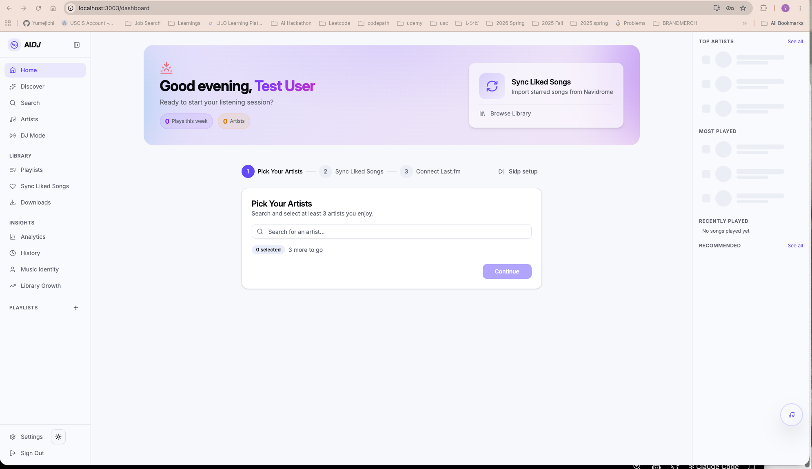
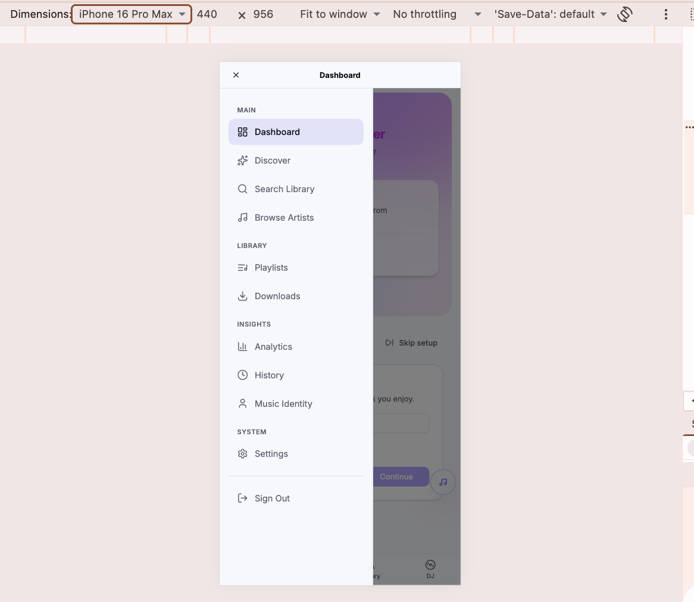

# Contribution: Add Tasks Center (/tasks) to the sidebar and mobile nav

Path: `beat-2-contribution/contribution-story.md`

This file is Assignment 5, and it is graded at the path above; a copy kept anywhere else in
the repository is not read. **Keep every section header below under its exact name** — the
format criteria grade exactly that. Your course repo link is the whole submission: no tool
files and no evidence uploads are part of Assignment 5.

**Contribution Number:** [1]
**Student:** Yumejichi Fujita
**GitHub Username:** Yumejichi
**Issue:** https://github.com/lolimmlost/aidj/issues/266
**Pull Request:** [GitHub PR link, once opened]

One repository, built across units 5 to 8, telling the whole story of your real
contribution. Fill it as you work, not at the end — the sections below ask for evidence that
is far easier to write down as it happens than to reconstruct in the last weekend.

Contribution Number stays `[1]` unless you make more than one contribution this term; it
just numbers them.

---

## Toolkit

Every story section below, from Why I Chose This Issue through Pull
Request, ends with a Toolkit block: which tool did that phase's work
and how you used it, what it produced, what difficulties or
shortcomings it presented, and what you changed or would change
because of them. Together the blocks are the thread the rubric's
Toolkit points read, and they are the raw material for your unit-9
portfolio, so keep them current as you work rather than
reconstructing them later.

A Toolkit block looks like this (copy it into each story section and
fill it there):

```text
**Toolkit**

- Tool: [which tool did this phase's work, and how you used it]
- What it produced: [described in a sentence or a short excerpt]
- Difficulties: [what fought you or fell short, or "none met"]
- What changed: [the patch, revision, or workaround, what you would
  update, or "nothing"]
```

This section also keeps one short dated entry per week of tool work,
starting below: what you built or changed that week, what broke, and
what you changed because of it. The blocks tell the story where it
happened; these entries are the toolkit's own timeline.

All four entries are graded. Keep every heading below, and fill each
one in the week it belongs to.

**Unit 5: Adapted and tested an issue scout for my Python and web-development interests**

I broadened my fit profile beyond React UI work, updated the scout's Python, JavaScript, and TypeScript search queries, and tested them before scanning. The scan ran into a GitHub rate limit and exposed ranking limits: zero-comment ties and technically acceptable issues that were poor personal fits. I recorded those limits in my scan notes and used the course Issue Selection site to find two `aidj` issues that the scout accepted. Grading showed that both are more ambitious than their “good first issue” labels suggest, so I will check the maintainer's scope before choosing and claiming one.

**Unit 6: Checked my claim with a voice guard and wrote local repo notes**

I used the voice guard to check my claim before posting it on GitHub. It blocked my first draft because my scope question did not explain what I had read, so I added that context and the revised comment passed. I also wrote `CLAUDE.local.md` with the repo’s rules, navigation files, test references, and AI-policy notes, and kept it out of Git using `.git/info/exclude`. The first navigation exploration incorrectly said the repo was not cloned, so I reran it against my local checkout before summarizing the findings.

**Unit 7: [one line on the tool work]**

[2-4 sentences: the ship-gate and your gate manifest. What it produced
on your real branch, what fought you, what changed because of it.]

**Unit 8: [one line on the tool work]**

[2-4 sentences: the PR-monitor and your playbook. What it read, what it
drafted, what you did with the draft.]

---

## Why I Chose This Issue

I found AIDJ #266 on the CodePath Issue Selection site. My issue-scout graded it alongside AIDJ #285, the keyboard shortcuts overlay issue, and accepted both. The Unit 6 regrade still rated #266 ambitious because the maintainer also asked for Library Growth in mobile navigation and suggested a broader navigation audit related to #288. I chose #266 because its main request is concrete and fits my JavaScript/TypeScript and React interests: make existing pages easier to reach on desktop and mobile. I preferred it over #285 because that issue involves several connected parts, including a shortcut registry, dialog, and tooltips. I also looked for a more widely used project, but the alternatives had concerns such as old reports, unfinished dependencies, or uncertain availability. For my first contribution, I decided that a focused change I can understand and test matters more than repository popularity.

I want to learn how to set up an unfamiliar app, understand its navigation, write useful tests, and communicate with a maintainer. I have not run the app locally yet. In my claim, I proposed adding Tasks to desktop and mobile navigation and Library Growth to mobile, excluding the broader audit and #288, and asked whether that scope would work. I promised to report my findings by November 13; the proposed scope is not yet confirmed by the maintainer. The scout helped surface the extra scope hidden behind the good-first-issue label, but an accepted verdict did not tell me whether an issue was the best fit for my time and interests. Its November 9 regrade reused earlier evidence, so I checked the current thread before claiming rather than treating that output as a fresh availability check.

**Claim comment:** https://github.com/lolimmlost/aidj/issues/266#issuecomment-6782455777

**Toolkit**

- Tool: I used issue-scout with my fit profile, search strategy, and rubric to scan candidates and directly grade the two AIDJ issues from the course site. I then used the patched rubric to regrade them for Unit 6.
- What it produced: Both AIDJ #266 and #285 were accepted and rated ambitious. For #266, the difficulty note identified the maintainer's expanded navigation request as the question to clarify in my claim.
- Difficulties: The scout helped me find possible issues, but I still needed to check its reasoning. It reused earlier information and made the suggested navigation audit sound required. For #285, it also used commits as evidence when my rubric required a maintainer comment, review, or merge.
- What changed: I replaced the original `scope-fits-newcomer` check with `scope-feasible` and added difficulty notes, recording the replacement in scan-notes.md. This lets a single identifiable task pass while recording design uncertainty separately. Because the patch was already installed, the Unit 6 regrade did not change the AIDJ verdicts or difficulty ratings. I reread #266's discussion and narrowed my proposed scope in the claim; I would improve future recommendations by checking issue age, dependencies, and practical fit before treating an accepted issue as a strong choice.

---

## Understanding the Issue

**Problem Description**

[In your own words, what is broken or missing?]

**Expected Behavior**

[What should happen?]

**Current Behavior**

[What actually happens?]

**Affected Components**

[Which parts of the codebase are involved?]

**Toolkit**

- Tool:
- What it produced:
- Difficulties:
- What changed:

---

## Reproduction Process

**Environment Setup**

Reproduced on November 10, 2026.

- macOS with Chrome.
- Node.js 22.23.4 and npm 10.9.9.
- Local PostgreSQL using postgres:16-alpine through compose.local.yml.
- App running at http://localhost:3003 with npm run dev.
- Signed in with a local test account.
- Desktop: wide Chrome window.
- Mobile: Chrome DevTools iPhone 16 Pro Max emulation,
  440 × 956, portrait. No physical phone was tested.
- Navidrome was not configured. This reproduction checks navigation
  links, not music playback or task execution.
- Tested revision: b81906e73b1e19d63241f0a607fa97751525aaa7
- Branch: main

During setup, signup failed because the user table did not exist.
I initialized the local database from the repository's schema with
npm run db -- push. After that, signup succeeded.

**Steps to Reproduce**

1. Start the local database:
   docker compose -f compose.yml -f compose.local.yml up -d db
2. Start the app with npm run dev.
3. Open http://localhost:3003 and sign in with a local test account.
4. Open the dashboard in a wide Chrome window with the sidebar expanded.
5. Check whether the desktop sidebar includes a Tasks link near Downloads
   and whether Library Growth appears under Insights.
6. Enable Chrome DevTools device emulation at 440 × 956 in portrait.
7. Open the mobile navigation menu and check whether Tasks and
   Library Growth appear.

Expected:
- Tasks is available next to Downloads in desktop and mobile navigation.
- Library Growth is available in mobile navigation.

Actual:
- The desktop sidebar includes Downloads and Library Growth,
  but no Tasks link.
- The mobile menu includes Downloads, but neither Tasks nor
  Library Growth.

**Reproduction Evidence**

- **Commit showing reproduction:** none; the tested revision is recorded above.
- **My findings:** Tasks is missing from both navigation layouts. Library Growth is present in the desktop sidebar but missing from the mobile menu.

Desktop sidebar: Tasks is missing; Library Growth is present.



Mobile menu: Tasks and Library Growth are both missing.



No navigation code was changed before capturing these screenshots.

**Toolkit**

- Tool: I used repro-check to grade my claim and reproduction report together.
- What it produced: It checked my report and screenshots against the issue. All five checks passed after one revision.
- Difficulties: My first draft did not identify the Git revision I tested.
- What changed: I added the tested commit hash and branch, then reran the check successfully.

---

## Solution Approach

**Analysis**

[Your analysis of the root cause: what is causing the issue, traced
to the files and functions involved.]

**Proposed Solution**

[High-level description of your fix approach, and what you are
deliberately NOT changing.]

**Implementation Plan**

1. [Modify file X to do Y]
2. [Add or change Z]
3. [Update tests]

[Record deviations here as they happen: what changed mid-build and
why. A recorded deviation is honest work; silent drift is not.]

**Toolkit**

- Tool:
- What it produced:
- Difficulties:
- What changed:

---

## Testing Strategy

[What observable checks prove the fix: your reproduction steps re-run
against the built change (before and after), and the repo's own test
suite or checks with the outcome shown. "Tests pass" with nothing
observable named is not a strategy.]

**Toolkit**

- Tool:
- What it produced:
- Difficulties:
- What changed:

---

## Implementation Notes

[A running log, added to as you work. Date each entry. What you
built, decisions you made when you made them, wrong turns included.]

**[Date]**

[Entry]

**[Date]**

[Entry]

**Toolkit**

- Tool:
- What it produced:
- Difficulties:
- What changed:

---

## Pull Request

**PR Link:** [GitHub PR URL when opened]

**PR Description:** [what the PR says; much of the content above
adapts into it]

**Maintainer Feedback:**

- [Date]: [feedback received, or "none yet"; silence is a normal
  state and costs you nothing]
- [Date]: [how you addressed it]

**Status:** [Awaiting review / Iterating / Merged / Closed. The
status is a fact you record, never a grade: the PR is graded as
opened.]

**Toolkit**

- Tool:
- What it produced:
- Difficulties:
- What changed:

---

## Learnings and Reflections

**Technical Skills Gained**

[What you learned technically, named concretely.]

**Challenges Overcome**

[What was hard and how you solved it; point at the real events, the
Toolkit blocks above are full of them.]

**What I'd Do Differently Next Time**

[Reflection on your process.]

---

## Resources Used

[What actually helped, not a reading list. List things this story
already shows you using: the doc you followed to set the environment
up, the thread that explained the bug, the person who answered you.
One real entry beats ten plausible ones.]

- [Link to documentation that helped]
- [Discussion, issue, or post that helped]
