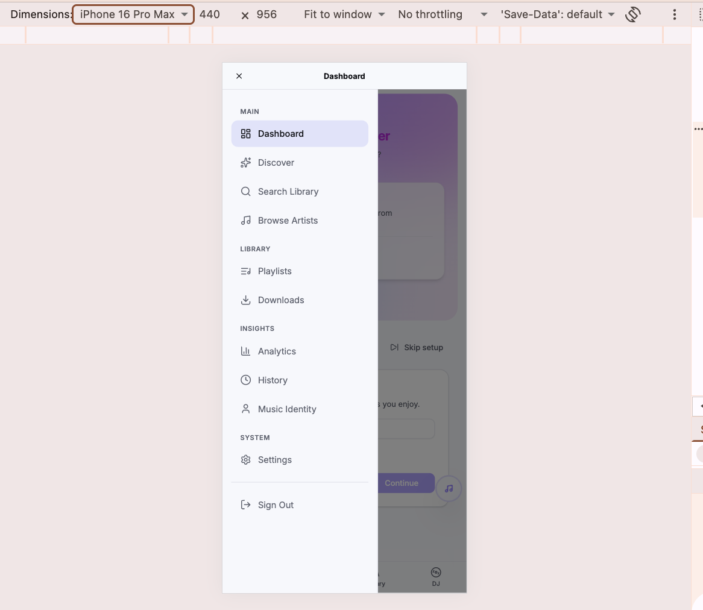

# Fixing AIDJ’s Navigation and Improving My PR Checks

## Overview

AIDJ is a self-hosted AI DJ app. I found that the Tasks link was missing from desktop and mobile navigation, and Library Growth was missing from the mobile menu. I fixed the links, added tests, and opened [PR #408](https://github.com/lolimmlost/aidj/pull/408) using Claude Code. The maintainer approved and merged it. I used Claude Code to configure and run the course-provided ship-gate before opening the PR. The ship-gate caught an incomplete AI disclosure, but a pr-precheck rubric rule used by ship-gate was too strict about the disclosure heading. I updated that rule and clarified what help I had used.

## What happened

I ran AIDJ locally and signed in with a test account. The desktop sidebar had a Library Growth link but no Tasks link. In Chrome’s mobile view, both links were missing. I confirmed with the maintainer that this PR should fix those links and leave a broader navigation review for another PR.

With Codex’s help, I drafted and reviewed six mobile navigation tests. They checked the links and page titles for Downloads, Tasks, and Library Growth. Before the fix, the two Downloads tests passed and the other four failed.

I added the missing links and mobile page titles using the app’s existing patterns. During review, Codex spotted that I had swapped the Music Identity and Library Growth destinations. I corrected them and reran the tests. All six passed. I also checked the desktop sidebar and mobile menu in the browser.

| Checks | Before the fix | After the fix |
|---|---:|---:|
| Downloads link and title | 2 passed | 2 passed |
| Tasks and Library Growth links and titles | 4 failed | 4 passed |

Using Claude Code, I configured the ship-gate to run unit tests, lint, and a production build. All three passed. Its PR description check then rejected my AI disclosure because I had put it under “AI assistance” instead of “Notes for Reviewers.” It also caught that I had not mentioned Codex’s help with testing.

The repository did not require a specific disclosure heading, so I changed the pr-precheck rubric rule used by ship-gate to accept an accurate disclosure under any clear heading unless the repository says otherwise. I also updated my disclosure to include the testing help. The next check passed. My final PR description used “Notes for Reviewers,” so that run did not prove the revised rule would accept another heading.

**Earlier rubric rule:**

> In live course work require the course AI-use disclosure in Notes for Reviewers.

**Revised rubric rule:**

> Accept it under any clear heading or within an existing template section unless the repository explicitly requires a particular location or heading.

I used Claude Code to open PR #408 with the tests and navigation fix in separate commits and included before-and-after screenshots. On November 14, the maintainer tested the changes on desktop and a phone in portrait, then approved and merged the PR. They said the links appeared, highlighted correctly, and showed the right titles. The screenshots and separate test commit also made the review easier.

> “Tasks and Library Growth both show up, highlight correctly, and the titles are right.”

[Read the maintainer’s review](https://github.com/lolimmlost/aidj/pull/408#pullrequestreview-5905793573)

## Limitations and what's next

The ship-gate setup worked for this contribution, but I would review it before using it on another project. I would read that repository’s CONTRIBUTING.md, PR template, and CI configuration, then update the commands and rules to match. This experience reminded me that a course-specific requirement should not automatically become a rule for every repository.
